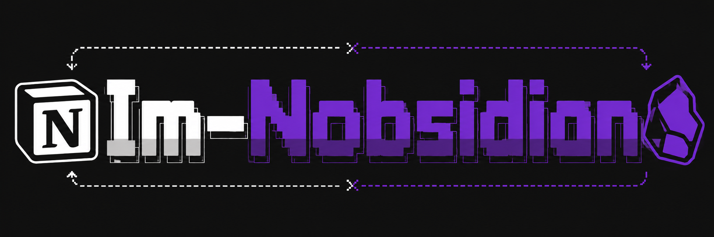

<p align="center">
  
</p>

<h1 align="center">Im-Nobsidian</h1>

<p align="center">
  <strong>세계 최초이자 유일한 Obsidian ↔ Notion 양방향 동기화 도구.</strong>
</p>

<p align="center">
  <a href="https://github.com/JaylenAI/Im-Nobsidian/actions/workflows/ci.yml"></a>
  <a href="https://www.npmjs.com/package/im-nobsidian"></a>
  <a href="LICENSE"></a>
  <a href="https://nodejs.org"></a>
  <a href="https://www.npmjs.com/package/im-nobsidian"></a>
</p>

<p align="center">
  <a href="README.md">English</a> · <a href="docs/06-devlog/CHANGELOG.md">변경 이력</a> · <a href="CONTRIBUTING.md">기여 가이드</a> · <a href="SECURITY.md">보안 정책</a>
</p>

---

Obsidian에서 편집하면 Notion에 반영됩니다. Notion에서 편집하면 Obsidian에 반영됩니다. 복사-붙여넣기도, 내보내기-가져오기도, 수동 동기화도 필요 없습니다. `nobsi sync` 한 번이면 양쪽이 완벽하게 동기화됩니다 — 서식, 속성, 폴더 구조 모두.

모든 경쟁 도구는 단방향입니다. Im-Nobsidian은 진정한 **양방향** 동기화와 충돌 해결, 속성 매핑, 왕복 보존을 제공하는 최초이자 유일한 오픈소스 프로젝트입니다.

## 주요 특징

**진정한 양방향 동기화** &nbsp; 어느 쪽에서 편집하든 양쪽에 반영됩니다. "내보내고 가져오기"가 아닌, 변경 감지와 델타 업데이트 기반의 실제 양방향 동기화입니다.

**25+ 블록 타입 보존** &nbsp; 제목, 코드 블록, 수식(LaTeX), 콜아웃, 토글, 테이블, 체크리스트, 컬럼, 구분선, 임베드, 미디어(audio/video/pdf/file), 탭 블록 — 모두 양방향으로 정확하게 변환됩니다. 색상, 밑줄, Notion 전용 블록은 보존 마커로 라운드트립이 보장됩니다.

**스마트 부분 업데이트** &nbsp; 변경이 적을 때는 전체 덮어쓰기 대신 search-and-replace로 부분 업데이트합니다. 같은 페이지에서 다른 사람이 편집한 내용이 보존됩니다.

**프론트매터 ↔ Notion 속성** &nbsp; YAML 프론트매터가 Notion 데이터베이스 속성에 직접 매핑됩니다. 21종 읽기 + 15종 쓰기를 지원하며, 읽기전용 속성(formula, rollup 등)은 자동으로 스킵됩니다.

**충돌 해결 내장** &nbsp; 양쪽에서 같은 파일을 수정하면 Im-Nobsidian이 감지하고, 실제 원격 내용을 비교하여 보여줍니다. 로컬 유지 / 원격 유지 / 수동 해결 중 선택할 수 있습니다. 데이터 유실은 절대 없습니다.

**다중 데이터베이스 동기화** &nbsp; 여러 Notion 데이터베이스를 각각 별도 로컬 폴더에 동기화합니다. 데이터베이스별 속성 매핑과 필터를 설정할 수 있으며, 데이터베이스 페이지가 프론트매터 속성을 가진 개별 마크다운 파일이 됩니다.

**파일 첨부 자동 다운로드** &nbsp; Notion의 Excel, PDF, Jupyter Notebook 등 파일 첨부가 자동으로 로컬 볼트에 다운로드됩니다. 내부 `file://` 프로토콜 링크도 Notion API를 통해 해석되어 로컬에 저장됩니다.

**깊은 자식 페이지 탐색** &nbsp; 리스트, 문단, 제목, 토글 등 어떤 블록 안에 중첩된 자식 페이지도 발견하여 동기화합니다. 최상위 자식만이 아닌, 계층 구조의 모든 페이지를 찾아냅니다.

**폴더 구조 = 페이지 계층** &nbsp; Obsidian 폴더 트리가 Notion 페이지 계층에 1:1로 매핑됩니다. `프로젝트/기획안.md` → Notion "프로젝트" 하위 "기획안" 페이지.

**설정 없는 상태 관리** &nbsp; 데이터베이스 설치도, 서버 실행도 필요 없습니다. `.im-nobsidian/` 폴더의 로컬 SQLite 파일로 자동 관리되며, 유저가 만질 일은 없습니다.

**Notion DB → Obsidian Bases** &nbsp; Notion 데이터베이스가 자동으로 Obsidian Bases `.base` 파일로 변환됩니다. 갤러리 뷰는 `file.embeds[0]` formula로 커버 이미지가 자동 표시됩니다. 테이블, 카드, 리스트 뷰와 정렬/그룹핑/속성 순서가 Notion Views API에서 매핑됩니다.

**라이브러리 + CLI + 플러그인** &nbsp; CLI 도구로 사용하거나, Node.js 라이브러리로 커스텀 연동을 만들거나, Obsidian 플러그인으로 설치할 수 있습니다.

## 빠른 설치

### Linux, macOS, WSL2, Termux

```bash
curl -fsSL https://raw.githubusercontent.com/JaylenAI/Im-Nobsidian/main/scripts/install.sh | bash
```

### Windows (PowerShell)

```powershell
irm https://raw.githubusercontent.com/JaylenAI/Im-Nobsidian/main/scripts/install.ps1 | iex
```

### 직접 설치

Node.js 22+가 이미 있다면:

```bash
npm install -g im-nobsidian
```

설치 없이 바로 실행:

```bash
npx im-nobsidian sync
```

## 시작하기

### 1. Notion Integration 생성

1. [notion.so/my-integrations](https://www.notion.so/my-integrations) 접속
2. **"새 통합 만들기"** 클릭 → 이름 입력 → 제출
3. **Internal Integration Secret** 복사 (`ntn_`으로 시작)

### 2. 페이지에 연결

Notion에서 동기화할 페이지 열기 → 우측 상단 `···` → **연결** → 생성한 통합 추가

### 3. 초기화

```bash
cd ~/your-obsidian-vault
nobsi init
```

대화형 설정이 토큰을 묻고, 사용 가능한 페이지를 보여줍니다. 선택하면 끝입니다.

### 4. 동기화

```bash
nobsi sync     # 양방향 — pull 후 push
nobsi push     # Obsidian → Notion만
nobsi pull     # Notion → Obsidian만
nobsi watch    # 파일 변경 감시 + 자동 동기화
```

이제 볼트와 Notion 워크스페이스가 연결되었습니다.

## 실제 동작

<table>
<tr>
<td align="center"><strong>nobsi init</strong></td>
<td align="center"><strong>nobsi sync</strong></td>
</tr>
<tr>
<td></td>
<td></td>
</tr>
<tr>
<td align="center"><strong>nobsi push</strong></td>
<td align="center"><strong>nobsi pull</strong></td>
</tr>
<tr>
<td></td>
<td></td>
</tr>
<tr>
<td align="center"><strong>nobsi status</strong></td>
<td align="center"><strong>nobsi diff</strong></td>
</tr>
<tr>
<td></td>
<td></td>
</tr>
<tr>
<td align="center"><strong>nobsi resolve</strong></td>
<td align="center"><strong>nobsi watch</strong></td>
</tr>
<tr>
<td></td>
<td></td>
</tr>
</table>

## CLI 명령어

| 명령어                    | 설명                                                                                                        |
| ------------------------- | ----------------------------------------------------------------------------------------------------------- |
| `nobsi init`              | 대화형 설정 — Notion 토큰 + 루트 페이지                                                                     |
| `nobsi push`              | 로컬 변경사항을 Notion에 반영                                                                               |
| `nobsi pull`              | Notion 변경사항을 로컬에 반영                                                                               |
| `nobsi sync`              | 양방향 동기화 (pull → push)                                                                                 |
| `nobsi status`            | 동기화 상태 + 충돌 표시                                                                                     |
| `nobsi diff [경로]`       | 로컬과 Notion 간 차이 표시                                                                                  |
| `nobsi discard <경로...>` | 로컬 편집 되돌리기 — 지난 동기화 때의 글로 (Notion 은 그대로)                                               |
| `nobsi prepare-db <폴더>` | 볼트의 노트 폴더(+ `.base`)를 다음 push 에서 Notion DB 로 — 속성 타입 · 보기를 정해 둔다 (Notion 은 그대로) |
| `nobsi fetch`             | 원격 변경 스캔 (신규/수정/삭제, 읽기 전용)                                                                  |
| `nobsi verify`            | 완결성 검증 — 원격 행·**페이지**가 볼트에 빠짐없이 있는가 (읽기 전용)                                       |
| `nobsi resolve`           | 동기화 충돌 해결                                                                                            |
| `nobsi watch`             | 파일 변경 감시 + 자동 동기화                                                                                |

`push`, `pull`, `sync`는 `--dry-run` 옵션으로 적용 없이 변경사항을 미리 볼 수 있습니다. `pull --force`는 바뀐 것만 받는 대신 지금 전체 대조합니다 — Notion 에서 지운 것을 반영하고, Notion 검색 인덱싱 지연으로 누락된 페이지를 복구합니다 ([Pull](#pull-notion--obsidian) 참고).

`pull --rerender`는 Notion 에서 바뀌지 않은 받아 둔 노트도 지금 변환기로 다시 그립니다 — 업데이트 뒤 옛 모양(Notion 블록을 가리키는 `🔖 Bookmark` 링크 등)으로 남은 노트를 고칩니다. 볼트에서 고친 노트 · 충돌 중인 노트는 건드리지 않고, 노트마다 Notion 을 읽으므로 노트가 많으면 오래 걸립니다(`--path` 로 좁힐 수 있음). 플러그인은 명령 **Pull from Notion (받아 둔 노트 다시 그리기)** 입니다.

`verify`는 `status`와 다른 질문에 답합니다 — "낡은 게 있는가"가 아니라 **"빠진 게 있는가"**입니다.
카운트가 아니라 **집합**을 두 축으로 대조합니다 — database 별 행, 그리고 root 하위 페이지. Notion에는
있는데 로컬에 없는 것이 하나라도 있으면 0이 아닌 코드로 끝납니다. 멱등성 검사(`pull`을 다시 돌려
변경 0을 확인하는 것)로는 이걸 잡을 수 없습니다 — 디스커버리가 매번 **같은 것을 똑같이** 놓치면
재실행 결과도 첫 실행과 같고, churn은 생성·수정만 세기 때문에 **두 번째 열거가 더 작아도** 일치와
구분되지 않습니다. CI 용으로는 `--json`을 붙이세요.

두 축은 **일부러 비대칭**입니다. 행은 로컬에만 있으면 원격 삭제 잔재이므로 실패입니다. 반면 페이지는
로컬 전용 항목을 보고만 하고 **실패로 만들지 않습니다** — 아직 push하지 않은 로컬 노트, root 페이지
자신, Notion 검색 색인 지연이 전부 정상적으로 여기 들어오기 때문입니다. 거짓 적색을 내는 게이트는
곧 무시당해 없는 것과 같아집니다. DB 모드에서는 root 서브트리가 없어 페이지 대조를 건너뜁니다.

### 비대화형 모드 (CI / 스크립트)

```bash
nobsi init --token ntn_xxx --root-page-id "https://www.notion.so/myspace/Notes-0123456789abcdef0123456789abcdef" --non-interactive
nobsi sync --dry-run
```

## 동작 원리

```
Obsidian 볼트                          Notion 워크스페이스
┌──────────────┐                    ┌──────────────────┐
│  프로젝트/    │   nobsi push       │  📄 프로젝트      │
│   기획안.md   │  ───────────────►  │    📄 기획안      │
│   메모.md     │                    │    📄 메모        │
│  회의록.md    │  ◄───────────────  │  📄 회의록        │
│              │   nobsi pull       │                   │
└──────────────┘                    └──────────────────┘
        │                                    │
        └──────── nobsi sync ────────────────┘
                    (양방향)
```

### Push (Obsidian → Notion)

1. 볼트의 `.md` 파일 스캔
2. SHA-256 해시로 마지막 동기화 상태와 비교
3. 변경된 파일 변환: 프론트매터 → 속성, 마크다운 → Notion 블록
4. Notion API로 페이지 생성/수정 (3 req/s 제한 준수)

### Pull (Notion → Obsidian)

1. 지난 pull 뒤에 Notion 에서 바뀐 것 — 페이지 · DB 행 · 스키마가 바뀐 DB — 만 찾고, 그 DB 만 조회합니다.
   바뀌지 않은 DB 는 요청을 쓰지 않습니다
2. 한 시간에 한 번(`sync.fullReconcileInterval`)은 대신 **전체 대조**합니다 — 루트 아래 페이지와 DB 를 모두
   읽습니다. 검색은 휴지통 페이지를 돌려주지 않아, pull 마다 추적 중인 페이지 · 행을 15개씩 차례로 Notion 에 묻습니다
   (작은 볼트는 pull 마다 모두). Notion 에서 지운 페이지는 그 아래 노트와 비게 된 폴더까지 함께 지웁니다. 범위 밖으로 옮긴
   페이지는 전체 대조가 알아봅니다
3. Notion 에서 다른 부모로 옮긴 페이지는 볼트에서도 옮깁니다(이름 그대로, 새 부모의 폴더로). 옮겨도 수정 시각이
   바뀌지 않아 전체 대조가 알아봅니다. 옮길 자리에 같은 이름이 있거나, 볼트에서 옮긴 것을 아직 올리지 않았거나,
   폴더에 설정 파일로 정한 DB(`notion.databases`)가 있으면 옮기지 않고 까닭을 보입니다. 찾아 둔 DB 가 든 폴더는 함께
   옮기고 그 `.base` 보기 · 임베드도 새 폴더를 가리키게 고칩니다(볼트에서 옮겨도 같습니다). 옮긴 노트를 경로로 적은
   링크(`[[폴더/노트]]` · `[x](폴더/노트.md)`)는 다른 노트에서 고칩니다.
   Notion 에서 바꾼 제목은 노트 frontmatter 의 `title:` 로 받고 파일 이름은 둡니다 — `sync.renameOnTitleChange`
   (플러그인: **설정 → Notion 에서 바꾼 제목으로 이름 바꾸기**)를 켜면 파일 이름을 바꾸고 그 노트를 가리키던 링크를
   같은 식으로 고칩니다
4. `last_edited_time`으로 변경 감지
5. Notion 블록 → 마크다운, 속성 → 프론트매터 변환
6. 이미지를 첨부파일 폴더에 다운로드 (중복 제거)

첫 pull · `pull --force` · 데이터베이스 모드는 늘 전체 대조합니다. `pull` · `sync` · `status` 는 어느 쪽으로
훑었는지와 마지막 전체 대조 시각을 알려 줍니다. 바뀐 것만 찾았고 `sync.deleteSync` 가 켜져 있으면 Notion 에서 지운
노트가 언제 반영되는지도 알려 줍니다. 플러그인은 사이드바에 마지막 전체 확인 시각을 보이고(마우스를 올리면 설명),
명령 **Pull from Notion (전체 확인)** 이 지금 전체 대조합니다.

### 충돌 해결

양쪽에서 같은 파일을 수정하면 `pull`/`sync`가 덮어쓰지 않고 충돌로 표시합니다. `nobsi resolve`를 실행해 파일별로 대화형으로 해결하거나 `--strategy`로 일괄 해결합니다:

- `local-first` — Obsidian 버전 유지
- `remote-first` — Notion 버전 유지
- `duplicate` — 양쪽 모두 유지 (`.conflict` 사본 생성)

대화형 모드에는 **merge** 옵션(충돌 마커를 사용한 3-way 자동 병합)이 추가됩니다. 기본 `sync.conflictStrategy`는 `manual`이며, 충돌은 표시만 되고 직접 해결하도록 남겨둡니다.

### CLI 와 플러그인을 같은 볼트에서

CLI 와 Obsidian 플러그인은 볼트마다 하나인 동기화 상태 DB(`.im-nobsidian/sync.db`)를 함께 씁니다.
그래서 한 번에 한쪽만 열 수 있습니다. 한쪽이 쥐고 있으면 다른 쪽은 멈추고 누가 쥐고 있는지 알립니다 —
예를 들어 CLI 명령은 Obsidian 을 닫거나 그 볼트의 플러그인을 끈 뒤 실행합니다. 같은 컴퓨터에서 비정상
종료한 프로세스가 남긴 잠금은 자동으로 넘겨받습니다. 아무것도 실행 중이 아닌데 안내가 계속 나오면
`.im-nobsidian/sync.db.lock` 을 지웁니다.

CLI 실행이 끝나기 전에 강제로 종료됐다면, 볼트 폴더에서 CLI 명령 하나(예: `nobsi status`)를 실행해 마지막
기록을 합친 뒤 플러그인에서 새로고침합니다.

CLI 와 플러그인은 함께 업데이트합니다 — 이전 버전은 잠금을 잡지 않습니다.

## 지원 변환 기능

| 기능                                   |       Push       |    Pull     |
| -------------------------------------- | :--------------: | :---------: |
| 제목, 본문, 볼드/이탤릭/취소선         |        ✅        |     ✅      |
| 코드 블록 (30+ 언어)                   |        ✅        |     ✅      |
| 순서/비순서/체크박스 리스트            |        ✅        |     ✅      |
| 링크 및 위키링크                       |        ✅        |     ✅      |
| 콜아웃 / Notion 콜아웃 블록 (접기)     |        ✅        |     ✅      |
| 수학 수식 (LaTeX, 인라인 + 블록)       |        ✅        |     ✅      |
| 테이블                                 |        ✅        |     ✅      |
| 구분선                                 |        ✅        |     ✅      |
| 토글 블록                              |        ✅        |     ✅      |
| 컬럼 레이아웃                          |        ✅        |     ✅      |
| 색상, 밑줄                             |        ✅        |   ✅ 보존   |
| 미디어 (audio / video / pdf / file)    |        ✅        |     ✅      |
| 탭 블록                                |        ✅        |   ✅ 보존   |
| 비디오 / 임베드 URL                    |        ✅        |     ✅      |
| 프론트매터 ↔ DB 속성 (21종)            |        ✅        |     ✅      |
| 하이라이트 (`==마크==`)                |        ✅        |     ✅      |
| 각주 (`[^1]`)                          |        ✅        |   ✅ 왕복   |
| 표 열 정렬                             |        ✅        |   ✅ 왕복   |
| 옵시디언 주석 (`%%…%%`)                | ✅ Notion 비노출 |   ✅ 복원   |
| 이미지                                 |        ✅        | ✅ 다운로드 |
| 파일 첨부 (xlsx, pdf, ipynb 등)        |        —         | ✅ 다운로드 |
| 커버 이미지 + 아이콘                   |        —         | ✅ 다운로드 |
| Notion 전용 블록 (bookmark, embed 등)  |        ✅        |   ✅ 보존   |
| Notion HTML 블록 ↔ `.html` 첨부        |        ✅        | ✅ 다운로드 |
| Notion 전용 블록 (버튼, 폼, 동기 블록) |        —         |   📌 보존   |

## 설정

`nobsi init` 후 설정은 `.im-nobsidian/config.json`에 저장됩니다:

```jsonc
{
  "notion": {
    "token": "ntn_...", // 통합 토큰
    "rootPageId": "...", // 루트 페이지 또는 데이터베이스 ID
    "parentMode": "page", // "page" 또는 "database"
  },
  "sync": {
    "direction": "both", // "push" | "pull" | "both"
    "conflictStrategy": "manual", // "local-first" | "remote-first" | "manual" | "duplicate"
    "deleteSync": false, // true: 한쪽에서 지운 노트를 다른 쪽에서도 지움 (플러그인은 늘 켬)
    "renameOnTitleChange": false, // true: Notion 에서 바꾼 제목으로 파일 이름을 바꾸고 링크를 고침
    "fullReconcileInterval": 3600, // Notion 전체 대조 주기(초) — 0 이면 pull 마다
    "notifications": "silent", // "silent": 동기화가 쓴 페이지는 알림을 보내지 않음(멘션 · 사람 속성) | "default"
  },
  "paths": {
    "include": ["**/*"], // 포함할 glob 패턴
    "exclude": [], // 제외할 glob 패턴
    "attachments": "attachments", // 이미지 다운로드 폴더
  },
}
```

CLI 는 볼트 맨 위의 `.im-nobsidian-ignore`(한 줄에 제외 패턴 하나, `#` 주석)도 읽습니다. 옵시디언 플러그인은 **설정 → 동기화 범위** 에 같은 패턴을 한 줄에 하나씩 적고, 연결 폴더마다 무시 파일을 읽습니다. 패턴 규칙은 [설정](docs/05-guides/CONFIGURATION.md#include--exclude) 을 보세요.
뺀 자리에 놓일 Notion 의 새 페이지는 받지 않습니다 — `pull` 과 `status --full` 이 경로로 알립니다.

## 데이터베이스 모드

페이지 트리 대신 Notion **데이터베이스**에 동기화할 수 있습니다. 각 마크다운 파일이 데이터베이스 행이 되고, 프론트매터가 데이터베이스 속성에 매핑됩니다:

```yaml
---
status: In Progress # → Select 속성
tags: [ai, project] # → Multi-select 속성
priority: 1 # → Number 속성
due: 2026-06-30 # → Date 속성
---
```

켜기 — `nobsi init` 은 묻지 않으므로 설정 파일에 직접 적습니다:

```jsonc
// .im-nobsidian/config.json
"notion": {
  "parentMode": "database",
  "databaseId": "<데이터베이스 ID>" // 없으면 페이지 모드로 동작합니다
}
```

## 볼트 하나에 Notion 워크스페이스 여럿

연결마다 볼트의 폴더 하나를 맡고, 그 폴더의 `.im-nobsidian/` 에 설정과 상태를 따로 둡니다
([ADR-038](docs/02-architecture/adr/038-connection-folders.md)). 볼트 최상위도 연결 하나입니다 — 예전부터 쓰던 그 연결입니다.

```bash
cd ~/Vault/Work && nobsi init   # 두 번째 연결: Work/ 는 다른 워크스페이스와 동기화
nobsi sync                       # 그 폴더에서 실행. 최상위 연결은 Work/ 를 건너뜀
```

플러그인에서는 **설정 → 폴더 연결 추가** 에서 폴더 · 키체인 토큰 이름 · 루트 페이지를 정합니다. 명령은 준비된 연결을
차례로 돌리고, 변경 패널에서 연결을 고를 수 있습니다.

- 바깥 연결이 이미 동기화하던 폴더는 따로 연결하지 않습니다 — 바깥 연결이 그 노트를 지운 것으로 읽습니다.
  `init` 이 거절하고, 동기화는 그런 폴더를 찾으면 멈춥니다.
- 연결 사이의 위키링크는 Notion 에서 글로 남습니다 — 페이지가 다른 워크스페이스를 가리킬 수 없습니다.

## 패키지

| 패키지                                              | 설명                                 | npm                                                                                                         |
| --------------------------------------------------- | ------------------------------------ | ----------------------------------------------------------------------------------------------------------- |
| [`@im-nobsidian/core`](packages/core)               | 동기화 엔진 — 변환, 상태, 충돌 해결  | [](https://www.npmjs.com/package/@im-nobsidian/core) |
| [`im-nobsidian`](packages/cli)                      | CLI 도구 (`nobsi` 명령어)            | [](https://www.npmjs.com/package/im-nobsidian)             |
| [`obsidian-im-nobsidian`](packages/obsidian-plugin) | Obsidian 플러그인 (사이드바 + DB 뷰) | v0.12.0 (릴리스 자산 / BRAT)                                                                                |

### 라이브러리로 사용하기

```typescript
import {
  SyncOrchestrator,
  ConfigManager,
  StateDB,
  NotionClient,
  NodeVaultFS,
} from "@im-nobsidian/core";

const config = await new ConfigManager("/path/to/vault").load();
const stateDb = StateDB.open("/path/to/vault/.im-nobsidian/sync.db");
const client = new NotionClient({ token: config.notion.token });
const vaultFs = new NodeVaultFS("/path/to/vault", config.paths);

const orchestrator = new SyncOrchestrator(config, stateDb, client, vaultFs);
await orchestrator.sync({ dryRun: false });
```

## 알려진 제한사항

동기화는 **멱등·수렴**입니다. 바뀐 게 없는 볼트를 다시 동기화하면 변경이 0건이며, 표기가 바뀌어야
하는 경우에도 **첫 왕복 한 번**에 자리를 잡고 그 뒤로는 움직이지 않습니다. 내용은 아래 표가 말하는
곳 말고는 왕복에서 살아남습니다 — 표는 Notion의 저장 모델이 *표기*를 제약하는 곳 가운데 알려진 것을
모은 것으로, 제약이 영구적인지 1회성 정규화인지에 따라 나눴습니다. 블록 API 방식
(`conversion.preferMarkdownApi: false`)은 더 잃습니다 — [설정](docs/05-guides/CONFIGURATION.md#prefermarkdownapi) 참고.

### 영구 제한

| 제한                                       | 원인                                                                                                             | 대응                                                                                                                                                                                                                                                         |
| ------------------------------------------ | ---------------------------------------------------------------------------------------------------------------- | ------------------------------------------------------------------------------------------------------------------------------------------------------------------------------------------------------------------------------------------------------------ |
| Notion 전용 블록                           | API가 버튼/폼/동기 블록에 `unsupported` 반환                                                                     | 콜아웃 플레이스홀더로 보존                                                                                                                                                                                                                                   |
| Rate limit                                 | 2026-09-09 부터 60초 고정 창: Business · Enterprise 분당 600, 그 밖의 플랜 분당 180                              | 내장 리미터(분당 약 171)가 `Retry-After` 를 따르고 429 면 작업자 전부를 함께 멈춤. 큰 워크스페이스의 첫 동기화는 약 1시간                                                                                                                                    |
| Soft break 블록 분리                       | 단일 개행이 Notion에서 별도 문단 블록이 됨                                                                       | 의도적 분리는 빈 줄(문단 구분)로 작성                                                                                                                                                                                                                        |
| 연속 빈 문단 압축                          | "빈 문단 N개" 개념이 Notion에 없어 1개로 정규화                                                                  | 의미적 차이 없음 — pull 시 블록 간격은 복원됨                                                                                                                                                                                                                |
| 노트 임베드 (`![[노트]]`)                  | Notion에 노트 트랜스클루전 개념이 없고, 커스텀 스킴 링크는 버림                                                  | **원문 그대로 텍스트로 보존** — 동기화 후에도 옵시디언에서 임베드로 렌더링                                                                                                                                                                                   |
| 첫 Push 위키링크                           | Notion 은 대상 페이지가 있어야 링크를 걸 수 있음                                                                 | 같은 push 가 대상이 생긴 뒤 그 노트를 다시 보냄(v0.4.0 부터) — 범위를 좁힌 push 의 범위 밖 · 올리지 않은 수정이 있는 노트는 다음 push 에서 풀림                                                                                                              |
| 볼트 밖 페이지 링크                        | 대상이 인테그레이션에 공유되지 않았거나 pull 대상이 아님                                                         | 끊긴 위키링크 대신 **클릭 가능한 `https://www.notion.so/…` 링크**(글자는 그 페이지 제목, v0.4.1 부터)로 유지 — 페이지 id 가 살아 있어 그 페이지가 볼트에 들어오면 정식 위키링크가 됨. 각주 앵커(`#<blockId>`)도 살려서 해당 블록으로 정확히 이동             |
| Notion 삭제·이름변경 늦음                  | 검색은 휴지통을 못 보고, DB 이름을 바꿔도 수정 시각이 그대로                                                     | pull 마다 추적 중인 페이지 15개씩 삭제를 물어, 큰 볼트는 몇 번의 pull 에 걸쳐 따라잡음. `nobsi pull --force` 또는 플러그인 명령 **Pull from Notion (전체 확인)** 이 지금 전체 대조. 주기(`sync.fullReconcileInterval`, 기본 1시간)를 `0` 으로 두면 pull 마다 |
| Notion 에서 블록만 지움                    | 블록을 지워도 페이지 수정 시각이 바뀌지 않아(API 실측) 어느 대조도 못 봄                                         | 그 페이지를 Notion 에서 다시 고칠 때 함께 받음. 지금 받으려면 `nobsi pull --rerender`                                                                                                                                                                        |
| 봇 멘션                                    | Notion Markdown API 가 봇 · 통합의 멘션을 내보내지 않음                                                          | 받은 노트에 없고, 그 노트를 push 하면 Notion 에서도 사라짐 — Notion 에서 다시 넣기                                                                                                                                                                           |
| 관계 페이지 값을 계산하는 수식             | API 가 관계 페이지의 속성을 계산하는 수식(`map(current.prop(…))`, 원본 표시 롤업의 `sum()`)과 롤업의 롤업을 거부 | push 는 그것 없이 DB 를 만들고 수식을 하나씩 출력 — Notion 에 붙여 넣으면 됨. 버튼 속성도 만들 수 없음                                                                                                                                                       |
| 대상 DB 밖 페이지를 가리키는 relation      | Notion 이 오류 없이 뺌(200 응답, 값 사라짐)                                                                      | push 는 대상 DB 안에서 찾은 relation 만 보내고 나머지는 알림                                                                                                                                                                                                 |
| 사람 속성의 손님                           | API 사용자 목록은 멤버와 봇만 주고 손님은 주지 않음                                                              | 손님(또는 두 멤버가 같은 이름)을 가리키는 값은 보내지 않음 — Notion 에서 고칠 것                                                                                                                                                                             |
| 파일 속성의 외부 파일                      | pull 은 주소만 적고 Notion 이 보이는 이름은 적지 않음                                                            | 그 행을 다시 올리면 이름 자리에 주소가 보임. 올린 파일은 이름을 지킴                                                                                                                                                                                         |
| 큰 첨부                                    | Notion 파일 하나의 업로드 상한(무료 플랜 5MB)                                                                    | 파일은 볼트에 남고 Notion 에는 `📎 이름` 자리표시 줄                                                                                                                                                                                                         |
| Notion 자동 링크                           | Notion 이 도메인처럼 보이는 글(`config.md` · `example.com`)에 링크를 검                                          | 올린 볼트는 글 그대로, 새로 받는 볼트는 링크                                                                                                                                                                                                                 |
| 커스텀 이모지 · 링크 미리보기              | Notion API 로 만들 수 없음                                                                                       | 글이나 링크로 받고, push 는 다시 만들지 않음                                                                                                                                                                                                                 |
| 콜아웃 별칭 · 접힘 (`[!faq]-` · `[!tldr]`) | Notion 콜아웃에 종류 이름 · 접힘 상태가 없음                                                                     | 올린 볼트는 표기를 지킴. 다른 볼트로 처음 받으면 아이콘이 같은 기본 종류(`[!question]`)                                                                                                                                                                      |
| 같은 토큰의 다른 기기 편집                 | 같은 통합 토큰을 쓰는 다른 기기의 쓰기는 이 도구의 쓰기와 구분되지 않음                                          | 아직 없음. 따로, push 와 약 1초 안의 Notion 편집은 덮일 수 있음 — Notion 에 조건부 쓰기가 없음 ([ADR-017](docs/02-architecture/adr/017-same-minute-remote-edit.md))                                                                                          |
| 표 칸 코드 속 `\|`                         | 표 칸의 파이프는 `\|` 로 적어야 하는데, Obsidian 은 코드 안의 `\` 를 그대로 보임                                 | Notion 에는 백슬래시 없는 파이프로 맞게 감 — 볼트 표시만 다름                                                                                                                                                                                                |
| 글 속 `$$`                                 | Notion 은 글의 `$$` 를 빈 수식으로, 글과 한 줄인 `$$ x $$` 를 빈 수식과 글로 읽음                                | 짝 없는 `$$` 는 글로, `$$ x $$` 는 인라인 수식으로 보냄(v0.4.0 부터). 한 문단 여러 줄에 걸친 `$$` 짝은 Obsidian 만 수식으로 그림                                                                                                                             |

### 1회성 정규화

*쓰는 방식*이 첫 왕복에서 한 번 바뀌고, 그 뒤로는 고정됩니다(이후 `nobsi status` 변경 0건).
내용이 사라지는 게 아니라, Notion이 실제로 저장할 수 있는 표기로 자리를 잡는 것입니다.

| 이렇게 쓰면                              | 첫 왕복 뒤                                  | 이유                                                                                                                                                                                                |
| ---------------------------------------- | ------------------------------------------- | --------------------------------------------------------------------------------------------------------------------------------------------------------------------------------------------------- |
| `\[이스케이프\]`                         | `[이스케이프]`                              | Notion은 마크다운 이스케이프가 아니라 평문을 저장하므로 백슬래시가 저장/내보내기를 통과하지 못합니다. 그래서 `\[\[노트\]\]` 는 진짜 위키링크가 됩니다 — 이스케이프로 위키링크를 숨길 수는 없습니다. |
| `%%im-nobsidian:toggle:start%%` … `:end` | `> [!toggle]- 제목`                         | Notion이 토글을 `<details>` 로 돌려주고, 이는 옵시디언 콜아웃 형태로 매핑됩니다. 마커 형태는 레거시 입력으로 계속 받습니다.                                                                         |
| 컬럼 _N_ 개짜리 컬럼 레이아웃            | 컬럼마다 `%%im-nobsidian:column%%` 마커 1개 | 마커가 두 컬럼을 나누는 구분자가 아니라 컬럼을 여는 표시라서, 첫 컬럼에도 하나 붙습니다.                                                                                                            |

펜스/인라인 코드 안의 이스케이프는 건드리지 않고, `\\[`(백슬래시 자체를 이스케이프한 것)도 그대로
둡니다 — 진짜 `\[` 만 정규화됩니다.

## 로드맵

```
v0.9.0 ✅ push 가 볼트에서 Notion DB 를 만듦(스키마 · 행 · relation · 롤업 · 수식 · 보기 ·
        아이콘/커버), 볼트 폴더 → Notion DB, 컬럼 열 경계 표시, 볼트 하나에 워크스페이스
        여럿(연결 폴더), 첫 pull 요청 −42%, 다른 루트로 옮겨도 사람 · 파일 속성 유지,
        릴리스 후보의 전체 워크스페이스 E2E 와 172 노트 재왕복
v0.4.1 ✅ 실데이터 왕복: 1,492 노트 새 루트로 올리기(346 → 1,492), 동기화 블록 원본을
        건드리지 않음, 글자에 붙은 인라인 수식, 제목에 `/` 가 든 자식 링크, 볼트 밖 멘션 제목,
        올린 직후 받기의 다시 쓰기 없앰
v0.4.0 ✅ Obsidian Git 식 증분 동기화(노트마다 올리기 · 받기 · 되돌리기, 줄 비교,
        주기 전체 대조, pull --rerender, --json), 데이터 안전(심층 QA 결함 23건과
        그 뒤 찾은 결함 — 편집 유실 · 페이지 중복 · 변경 누락), 블록 방식도
        NFM 변환 경로, 플러그인 파일 3개, 키체인 토큰, 실볼트 사본 E2E(3,235 파일 · 실패 0 ·
        반복 변화 0), 3980개 테스트
v0.3.2 ✅ 렌더 충실도(토글/표/콜아웃/코드펜스 — 결함 15종 + 본문 삼킴 코드펜스 봉합),
        동기화 견고성(pull 정지, 네트워크 시간상한, Retry-After, 링크 4종,
        CLI 종료코드), 삭제된 DB 행 복원,
        clean-slate 1268노트 실데이터 E2E(churn-0, 렌더 결함 0), 1662개 테스트
v0.3.1 ✅ steady-churn 근절(동명 인라인 DB 폴더 분리, linked view 컨테이너
        중복 제거), 옵시디언/HTML 주석 왕복, 페이지 멘션 URL 수정,
        clean-slate 887파일 실데이터 E2E(churn-0, 무손실), 1285개 테스트
v0.3.0 ✅ 왕복 충실도 일괄 봉합(주석/각주/하이라이트/표정렬/블록간격),
        증분 pull 누락 수정, --force 전체 스캔, Node 22+
v0.2.1  --version 동적 읽기 수정, 문서 현행화, 1038개 테스트
v0.2.0  100% 무손실·멱등·수렴, 불변식 안전망, npm 배포
v0.1.12 Pull 충실도 + 동기화 안정성, 중첩 DB→Bases, 갤러리 커버, 777개 테스트
v1.0.0  → 커뮤니티 등록, 멀티 워크스페이스, 1000+ 노트
```

전체 계획은 [ROADMAP.md](docs/06-devlog/ROADMAP.md)를 참고하세요.

## 개발

```bash
git clone https://github.com/JaylenAI/Im-Nobsidian.git
cd Im-Nobsidian
pnpm install
pnpm build
pnpm test          # 1662개 테스트
pnpm lint
pnpm typecheck
```

### 프로젝트 구조

```
packages/
├── core/              # @im-nobsidian/core — 동기화 엔진
│   ├── src/
│   │   ├── converter/     # Markdown ↔ Notion 변환 파이프라인
│   │   ├── notion/        # Notion API 클라이언트 + 속성 매퍼
│   │   ├── state/         # SQLite 상태 데이터베이스
│   │   ├── sync/          # 오케스트레이터, 변경 감지, 볼트 FS
│   │   ├── view/          # DB 뷰 렌더링 + Bases .base 파일 생성기
│   │   └── utils/         # 해시, 로거, 파일명 정제
│   └── tests/
├── cli/               # im-nobsidian CLI (nobsi 명령어)
└── obsidian-plugin/   # Obsidian 플러그인 (사이드바 + DB 뷰)
    └── src/views/         # Svelte 5 컴포넌트 (Gallery/Board/Table/Calendar/List/Timeline + 사이드바)
```

## 기여

기여를 환영합니다! 개발 환경 설정, 코드 스타일, PR 프로세스는 [기여 가이드](CONTRIBUTING.md)를 참고하세요.

```bash
git clone https://github.com/JaylenAI/Im-Nobsidian.git
cd Im-Nobsidian
pnpm install && pnpm build && pnpm test
```

## 개인정보 · 네트워크 사용

- **계정:** Notion 계정과 직접 만든 내부 통합 토큰이 필요합니다([시작하기](#시작하기)). 플러그인은 토큰을 Obsidian
  키체인에, CLI 는 `.im-nobsidian/config.json` 에 둡니다.
- **네트워크:** 플러그인과 CLI 는 Notion API(`api.notion.com`)와 Notion 의 파일 호스트(첨부 내려받기)에만
  접속합니다. 다른 곳으로는 아무것도 보내지 않습니다. 요청은 사용자가 부를 때(동기화 · 상태 확인 · 변경 패널 새로고침)와 켜 둔 자동 동기화 주기에만 갑니다.
- **파일:** 플러그인은 볼트 안만 읽고 씁니다. 동기화 상태를 볼트의 `.im-nobsidian/` 에 Node 파일 시스템 API 로
  쓰므로 데스크톱 전용입니다.
- **텔레메트리 · 광고 · 결제 없음.** 무료이며 전부 오픈소스([MIT](LICENSE))입니다.

## 보안

취약점 보고는 [보안 정책](SECURITY.md)을 참고하세요.

## 라이선스

[MIT](LICENSE) — built by [@JaylenAI](https://github.com/JaylenAI).
